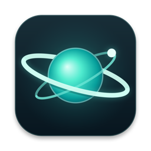

<p align="center">
  
</p>

<h1 align="center">Solis</h1>

<p align="center">
  <strong>마우스 커서 위치 기반 화면별 밝기 조절과 원클릭 HiDPI를 하나로 묶은 경량 네이티브 macOS 메뉴바 앱</strong>
</p>

<p align="center">
  <a href="https://github.com/isnow890/Solis/actions/workflows/ci.yml">
    
  </a>
  
  
  
  <a href="LICENSE">
    
  </a>
</p>

<p align="center">
  <a href="README.md">English</a> · <strong>한국어</strong>
</p>

---

## 소개

**Solis**는 **MonitorControl**과 **BetterDisplay**에서 가장 자주 쓰는 두 가지 핵심 기능만 뽑아, Electron 없이 순수 **Swift(SwiftUI + AppKit + Objective-C 브릿지)**로 만든 가벼운 macOS 메뉴바 유틸리티입니다.

- **마우스 커서 위치 기반 밝기 키**: `F1` / `F2`, `F14` / `F15`, `⌃⌥↑` / `⌃⌥↓` 입력 시 **현재 마우스 커서가 올라가 있는 디스플레이**의 밝기만 조절하며, 해당 화면 하단에 120Hz 부드러운 OSD HUD를 표시합니다.
- **3단계 화면별 밝기 제어 엔진**:
  - **Native (`DisplayServices`)**: MacBook 내장 Liquid Retina / XDR 및 Apple 호환 디스플레이
  - **하드웨어 DDC/CI (`IOAVService`)**: Apple Silicon 외장 모니터 백라이트 직접 제어 (포트별 직렬 큐 및 VCP 응답·재조회 검증)
  - **소프트웨어 디밍 (Overlay / Gamma LUT)**: DisplayLink 어댑터 연결 모니터, DDC 미지원 HDMI 휴대용 모니터 자동 폴백
- **네이티브 HiDPI & 주사율 전환**: 숨겨진 HiDPI/LoDPI 해상도와 소수 주사율(`59.94Hz`, `47.95Hz`, `120Hz`, `130Hz` 등)을 정밀하게 조회·전환합니다.
- **원클릭 가상 HiDPI 미러링 (`CGVirtualDisplay`)**: SIP 해제나 재부팅 없이 비-Retina 외장 모니터(세로 회전 포함)에 선명한 2× HiDPI 스케일링을 적용합니다.
- **Display Override 내보내기**: 영구 네이티브 HiDPI용 macOS `scale-resolutions` `.plist` 파일을 패널 기본 방향 기준으로 원자적 저장합니다.

---

## 설치 방법

### 방법 1: 릴리즈 실행 파일 다운로드 (GitHub Releases)

1. [Releases](https://github.com/isnow890/Solis/releases) 페이지에서 `Solis-vX.Y.Z-arm64.dmg` (또는 `.zip`)를 다운로드합니다.
2. **Solis.app**을 `/Applications` 폴더로 드래그합니다.
3. **비공증(ad-hoc) 릴리즈 빌드**의 경우 최초 실행 시 Gatekeeper 경고가 뜰 수 있습니다. 터미널에서 한 번만 격리 속성을 해제해 주세요:
   ```bash
   xattr -cr /Applications/Solis.app
   open /Applications/Solis.app
   ```

### 방법 2: 소스에서 직접 빌드

macOS 14+ (Apple Silicon) 및 Xcode Command Line Tools(`swift`)가 필요합니다.

```bash
git clone https://github.com/isnow890/Solis.git
cd Solis

# 로컬 ad-hoc 빌드 (Apple Development 인증서가 있으면 CODESIGN_IDENTITY 생략 가능)
CODESIGN_IDENTITY="-" ./scripts/build-app.sh --install
open /Applications/Solis.app
```

배포용 `.dmg` / `.zip` / 체크섬 패키징:

```bash
VERSION=0.1.0 ./scripts/package-dmg.sh
```

---

## 권한 설정 및 단축키

전역 밝기 키 가로채기를 사용하려면 아래 경로에서 `Solis`를 허용해 주세요:

- **macOS 14~26**: `시스템 설정 → 개인정보 보호 및 보안 → 손쉬운 사용`
- **macOS 27+**: `시스템 설정 → 개인정보 보호 및 보안 → 기기 제어 및 데이터 접근`

| 단축키 | 동작 |
| :--- | :--- |
| `☀` 밝기 키 · `F14` / `F15` | 대상 디스플레이 밝기 조절 (기본: 마우스 커서 위치 화면) |
| 표준 `F1` / `F2` | 설정의 *표준 F1/F2로 화면 밝기 조절* 활성화 시 사용 (`fnState=1`이면 자동 활성화) |
| `⌥ + ⇧ + 밝기 키` | 1/64 단위 미세 밝기 조절 |
| `⌃ + ⌥ + ↑ / ↓` | 외장 키보드용 대체 단축키 |

---

## 읽기 전용 진단 CLI

화면 밝기나 해상도를 변경하지 않고 연결된 모니터·DDC/CI 응답·이벤트 탭 마스크·HiDPI 목록을 점검할 수 있습니다:

```bash
/Applications/Solis.app/Contents/MacOS/Solis --diagnose
```

---

## 알려진 한계 및 주의사항

Solis는 개인 멀티모니터 환경을 위해 제작·공개된 오픈소스(MIT, As-is) 프로젝트입니다.

1. **비공개 macOS API 사용**: `DisplayServices`, `IOAVService`, `CGVirtualDisplay`를 사용합니다. 향후 macOS 업데이트로 심볼이 변경될 수 있으며, Solis는 동적 로딩으로 미지원 시 안전하게 폴백합니다.
2. **Mac App Store 미지원**: 전역 `CGEventTap` 및 `IOAVService` DDC/CI는 App Sandbox 정책상 Mac App Store 심사를 통과할 수 없어 직접 배포(GitHub Releases)로만 제공합니다.
3. **모니터·어댑터별 DDC 호환성**: DDC/CI 지원 여부는 모니터·허브·케이블 조합마다 다릅니다. DisplayLink 어댑터 경유 모니터는 하드웨어 DDC가 불가능하므로 자동으로 소프트웨어 오버레이/감마 디밍을 사용합니다.
4. **가상 HiDPI 미러링**: 가상 디스플레이는 앱 프로세스 수명에 종속됩니다. 정상 종료 시 기존 미러 관계를 복구하지만, 강제 종료(`SIGKILL`) 시에는 시스템 설정에서 화면 배치를 다시 확인해야 할 수 있습니다.

---

## 라이선스

[MIT License](LICENSE)로 배포됩니다.
