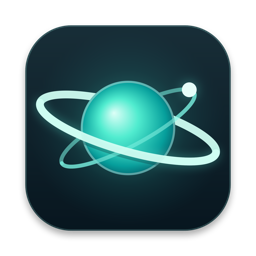

<p align="center">
  
</p>

<h1 align="center">Solis</h1>

<p align="center">
  <strong>Lightweight native macOS menu bar app for cursor-aware per-display brightness &amp; HiDPI scaling.</strong>
</p>

<p align="center">
  <a href="https://github.com/isnow890/Solis/actions/workflows/ci.yml">
    
  </a>
  
  
  
  <a href="LICENSE">
    
  </a>
</p>

<p align="center">
  <strong>English</strong> · <a href="README.ko.md">한국어</a>
</p>

---

## Overview

**Solis** brings the two most-used features of **MonitorControl** and **BetterDisplay** into one minimal, fast, pure-Swift macOS menu bar utility — with zero Electron overhead and no bloated preferences tree.

- **Cursor-Aware Brightness Keys**: Press `F1` / `F2`, `F14` / `F15`, or `⌃⌥↑` / `⌃⌥↓` to adjust **whichever display your mouse cursor is currently on**, with a smooth 120Hz translucent HUD on that exact screen.
- **3-Tier Brightness Control**:
  - **Native (`DisplayServices`)** for MacBook built-in Liquid Retina / XDR & Apple displays
  - **Hardware DDC/CI (`IOAVService`)** for Apple Silicon external monitors (per-port serial queues & VCP readback verification)
  - **Software Dimming (Overlay / Gamma LUT)** automatic fallback for DisplayLink adapters, DDC-less HDMI portable monitors, and sub-hardware dimming
- **Native HiDPI & Refresh Rate Switcher**: Exposes hidden HiDPI/LoDPI modes and fractional refresh rates (`59.94Hz`, `47.95Hz`, `120Hz`, `130Hz`, etc.).
- **One-Click Virtual HiDPI Mirroring (`CGVirtualDisplay`)**: Adds sharp 2× HiDPI scaling to non-Retina external monitors (including rotated portrait displays) without rebooting or disabling SIP.
- **Display Override Export**: Export native macOS `scale-resolutions` `.plist` files for permanent EDID-level HiDPI.

<!-- Add screenshots here once captured:
<p align="center">
  
  
</p>
-->

---

## Installation

### Option 1: Download Prebuilt App (GitHub Releases)

1. Download `Solis-vX.Y.Z-arm64.dmg` (or `.zip`) from the [Releases](https://github.com/isnow890/Solis/releases) page.
2. Drag **Solis.app** into your `/Applications` folder.
3. **If using an unnotarized / ad-hoc release build**, macOS Gatekeeper may block the first launch. Clear the quarantine attribute once:
   ```bash
   xattr -cr /Applications/Solis.app
   open /Applications/Solis.app
   ```

### Option 2: Build from Source

Requires macOS 14+ (Apple Silicon) and Xcode Command Line Tools (`swift`).

```bash
git clone https://github.com/isnow890/Solis.git
cd Solis

# Ad-hoc local build (or omit CODESIGN_IDENTITY to sign with your Apple Development certificate)
CODESIGN_IDENTITY="-" ./scripts/build-app.sh --install
open /Applications/Solis.app
```

To package a distributable `.dmg` and `.zip`:

```bash
VERSION=0.1.0 ./scripts/package-dmg.sh
```

---

## Permissions & Shortcuts

To intercept global brightness keys (`F1`/`F2`, `F14`/`F15`, `⌃⌥↑`/`⌃⌥↓`), grant Solis permission in:

- **macOS 14–26**: `System Settings → Privacy & Security → Accessibility`
- **macOS 27+**: `System Settings → Privacy & Security → Device Control and Data Access`

| Shortcut | Action |
| :--- | :--- |
| `☀` Brightness keys / `F14` · `F15` | Adjust brightness on the target display (default: cursor display) |
| Standard `F1` · `F2` | Supported when *"Use standard F1/F2"* is enabled in Settings (auto-enabled if `fnState = 1`) |
| `⌥ + ⇧ + Brightness Key` | Fine 1/64-step adjustment |
| `⌃ + ⌥ + ↑ / ↓` | External keyboard fallback shortcut |

---

## Diagnostics (Read-Only)

Run the built-in non-destructive hardware probe to inspect detected displays, DDC/CI status, event tap mask, and HiDPI modes:

```bash
/Applications/Solis.app/Contents/MacOS/Solis --diagnose
```

---

## Known Limitations & Honest Notes

Solis is shared as an open-source, as-is utility built for real Apple Silicon multi-monitor setups:

1. **Private macOS APIs**: Uses `DisplayServices`, `IOAVService`, and `CGVirtualDisplay` (the same underlying mechanisms used by MonitorControl and BetterDisplay). Future macOS updates can change private symbols; Solis loads them dynamically and fails safely when unavailable.
2. **Not on the Mac App Store**: Global `CGEventTap` and `IOAVService` DDC/CI are incompatible with App Sandbox and Mac App Store guidelines.
3. **Monitor / Adapter Variance**: DDC/CI behavior varies widely across monitors, hubs, and cables. DisplayLink adapters cannot pass Apple Silicon `IOAVService` DDC/CI, so Solis automatically falls back to Software Overlay / Gamma dimming.
4. **Virtual HiDPI Mirroring**: Virtual displays live in process memory and disappear when Solis quits. Solis restores previous mirror relationships on clean exit, though an abrupt crash (`SIGKILL`) may require re-arranging displays in System Settings.

---

## Architecture

```text
Sources/
├── CDisplayBridge/        # Thin Objective-C bridge (DisplayServices, IOAVService DDC/CI, CGVirtualDisplay)
└── Solis/
    ├── SolisApp.swift     # Pure AppKit menu bar entry point, custom template icon & --diagnose CLI
    ├── Models/            # DisplayItem, DisplayModeItem, VirtualDisplayPreset
    ├── Services/          # DisplayController, DDCChannel, BrightnessKeyMonitor, BrightnessOSDController,
    │                      # SoftwareDimmer, DisplayModeManager, VirtualDisplayManager, DisplayTopology
    └── UI/                # SwiftUI MenuBarPopoverView
```

---

## License

Released under the [MIT License](LICENSE).
